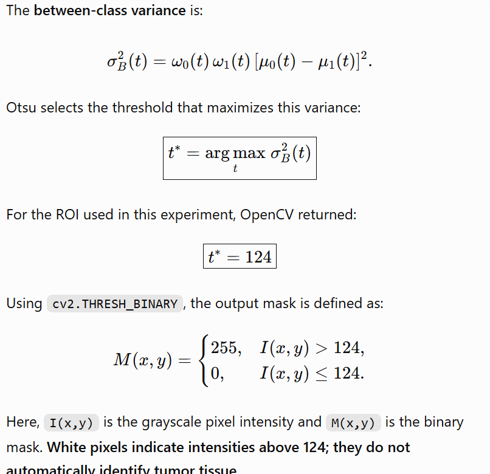

# CT Tumor Segmentation Using Otsu's Thresholding

## 1. Objective

This experiment investigates Otsu's automatic thresholding method for segmenting a suspected lesion in a brain CT JPG image. Unlike manual global thresholding, Otsu's method automatically selects an intensity threshold from the image data.

## 2. Methodology

### Step 1: Load and display the image

The image (`Tumor1.jpg`) was loaded using OpenCV (`cv2`) in grayscale format and displayed using Matplotlib. Because the input is an 8-bit JPG, pixel brightness values range from 0 to 255; these values are **not calibrated CT Hounsfield Units**.

### Step 2: Select a region of interest (ROI)

The image was visually inspected and a square ROI was positioned around the suspected lesion using an approximate center at **(x = 125, y = 90)**. The latest code screenshot specifies **35 × 35 pixels** for the square. The selected region was cropped from the grayscale image for analysis.

**Verification:** Confirm the ROI actually used for the reported result by running `print(roi.shape)`. If the notebook cell defining `roi` was not rerun after changing `size`, the threshold may have been computed on an earlier ROI.

### Step 3: Examine the ROI histogram

A histogram of the ROI pixel intensities was displayed using 256 bins spanning 0–255. Several intensity ranges overlap rather than forming two clearly separated peaks.

### Step 4: Apply Otsu's method

Otsu thresholding was applied to the ROI with OpenCV:

```python
otsu_T, otsu_mask = cv2.threshold(
    roi, 0, 255, cv2.THRESH_BINARY + cv2.THRESH_OTSU
)
```


Otsu's method selects a threshold that maximizes the between-class variance of pixel intensities. The reported result was **T = 124**. In the resulting binary mask, pixels above 124 are white (255), and pixels at or below 124 are black (0).

### Step 5: Visualize results

The original grayscale ROI, its intensity histogram with a vertical line at the Otsu threshold, and the resulting binary mask were displayed side by side.

## 3. Results and Discussion

Otsu automatically selected a threshold of **124**, avoiding the need to choose a value manually. The resulting mask classified much of the brighter central region as white and darker regions as black. However, it also showed irregular boundaries, small black holes within the bright region, and isolated white pixels outside it.

The ROI contains overlapping grayscale intensities. Consequently, a single intensity threshold may include surrounding tissue or exclude portions of the suspected lesion. Otsu distinguishes intensity classes; it does **not** identify tumor tissue or anatomical boundaries.

## 4. Limitations

- **Overlapping intensities:** The suspected lesion and neighboring tissue may have similar brightness values.
- **Irregular mask:** Small holes, isolated pixels, and uneven edges are visible.
- **ROI dependence:** Changing the ROI position or dimensions can change the histogram and selected threshold.
- **No spatial understanding:** Otsu uses pixel intensity, not anatomy or connectivity.
- **JPG input:** Display intensities are not calibrated CT Hounsfield Units, and JPEG compression can affect pixel values.
- **No reference annotation:** Segmentation accuracy cannot be established without an appropriate ground-truth or expert annotation.

## 5. Conclusion

Otsu's thresholding successfully selected an automatic threshold of **124** for the tested ROI, but the resulting mask was not a clean anatomical segmentation. This illustrates that automatic threshold selection does not necessarily solve the problem of overlapping tissue intensities. Future experiments could compare filtering, adaptive thresholding, or morphological post-processing, ideally with evaluation against a reference annotation.
